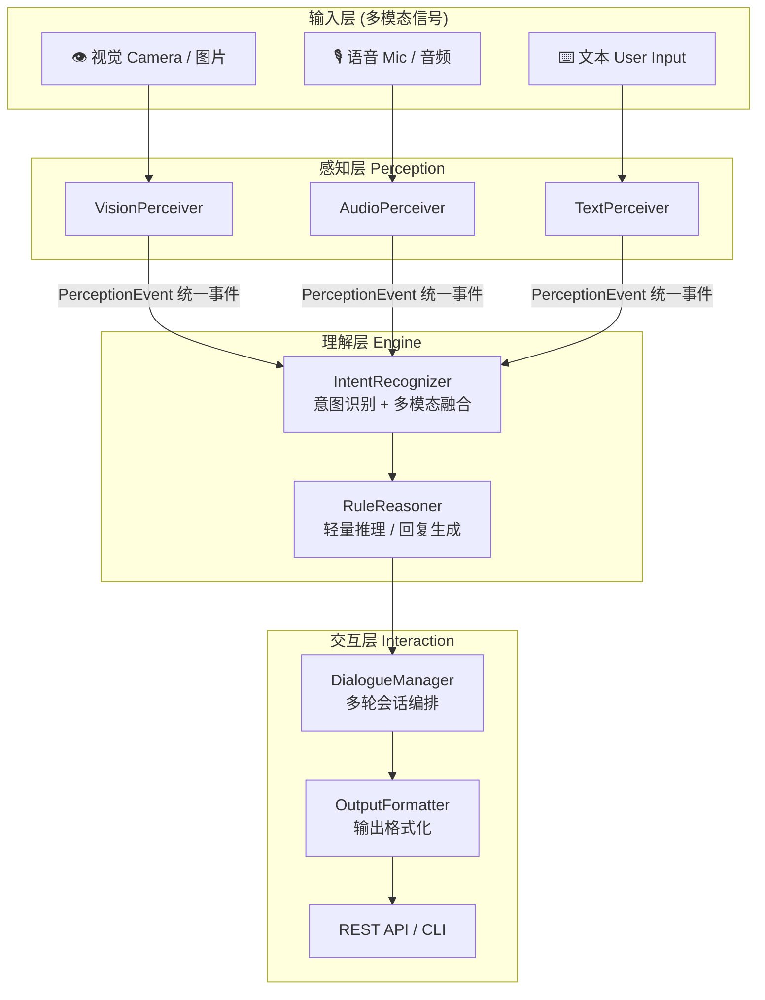

<div align="center">

# 多模态轻量化智能感知交互平台

**Multimodal Lightweight Intelligent Perception Interaction Platform**

> 面向边缘 / 低资源场景的多模态感知与交互框架 —— 让「看得见、听得清、答得上」在算力受限的设备上也能成立。

[](https://www.python.org/)
[](LICENSE)
[](#快速开始)
[](docs/architecture.md)

</div>

---

## 📖 项目简介

本平台是一个 **可落地的轻量化多模态智能感知与交互框架**，将三类模态——**视觉 (Vision)**、**语音 (Audio)**、**文本 (Text)**——的感知输入，通过统一的"感知 → 理解 → 交互"闭环，转化为可对话、可决策的自然语言响应。

它专为 **边缘计算、嵌入式设备、低算力服务器** 设计，核心思想是：

- **轻**：默认实现**零第三方硬依赖**，纯 Python 标准库即可运行，几十行代码即可启动；
- **活**：每个模块都是可替换的插件接口，可平滑接入 ONNX / TFLite / 轻量 LLM 等真正的推理模型；
- **全**：视觉、语音、文本三种模态统一收敛为结构化"感知事件"，天然支持多模态融合。

> 💡 **适合谁用**：想要快速搭建一个多模态感知 Demo 的学生与开发者、需要在边缘设备上部署感知交互能力的工程师、以及想学习"感知-理解-交互"三层架构的入门者。

---

## ✨ 核心特性

| 特性 | 说明 |
|------|------|
| 🧠 **统一感知抽象** | 视觉/语音/文本统一输出 `PerceptionEvent`，引擎无需关心模态差异 |
| 🚀 **零硬依赖运行** | 核心闭环纯标准库实现，`pip install` 即可启动 |
| 🔌 **插件式扩展** | 感知器可注入任意推理回调（ONNX / TFLite / LLM） |
| 🧩 **多模态融合** | 同时触发视觉+语音时自动收敛为"多模态意图" |
| 💬 **多轮对话** | 内置会话历史管理，支持上下文续接 |
| 🌐 **REST API** | 可选 FastAPI 接口，便于前端 / 网关 / 移动端接入 |
| ⚙️ **配置化** | YAML/JSON 配置，环境无依赖自动回退默认值 |
| 🧪 **可测试** | 内置标准库 `unittest` 测试套件，`一条命令`跑通 |

---

## 🏗️ 系统架构

### 分层架构



### 一次完整交互的流程

```text
用户输入 "看到 demo.jpg 并听听 demo.wav"
    │
    ▼
① 文本感知 TextPerceiver ──── 归一化 + 抽取信号词
② 视觉感知 VisionPerceiver ── 分析图片 → 视觉事件
③ 语音感知 AudioPerceiver ─── 分析音频 → 语音事件
    │
    ▼
④ 意图识别 IntentRecognizer ── 融合多模态 → 意图 = multimodal
    │
    ▼
⑤ 轻量推理 RuleReasoner ────── 依据意图 + 感知数据 → 自然语言回复
    │
    ▼
⑥ 交互输出 DialogueManager ─── 记录会话历史 → 返回给用户
```

---

## 🧩 技术栈

| 层 | 技术 / 依赖 | 备注 |
|----|------------|------|
| 语言 | Python 3.9+ | 纯标准库核心 |
| 感知(视觉) | `Pillow` *(可选)* | 图像特征分析；未安装自动回退 |
| 感知(语音) | `wave` / `struct` *(内置)* | 轻量 VAD 与能量分析 |
| 推理增强 | `onnxruntime` *(可选)* | 接入 ONNX 轻量模型 |
| API | `fastapi` + `uvicorn` *(可选)* | REST 服务 |
| 配置 | `PyYAML` *(可选)* | YAML 配置，缺省回退 JSON/默认值 |

> **轻量化卖点**：核心功能 **0 个第三方依赖**，可选依赖全部按需加载。

---

## 🚀 快速开始

### 1. 克隆并进入

```bash
git clone https://github.com/wanan-sion/-.git
cd -
```

### 2. 安装（可选，零依赖也能跑）

```bash
# 仅核心（无需任何安装，直接运行即可）
python3 app.py

# 若需要视觉增强 / API，可安装完整依赖
pip install -e ".[all]"       # 或: pip install -r requirements.txt
```

### 3. 运行命令行交互

```bash
python3 app.py
```

启动后即可对话：

```
你 > 你好
助手 > 你好！我是多模态轻量感知助手。你可以对我说“看看这张图”“听听这段音频”或“汇报状态”...
```

### 4. 一次完整的多模态感知演示

```bash
python3 scripts/demo.py
```

> 演示脚本会：完成问候 → 状态汇报 → 帮助 → 语音感知 四个闭环，展示完整交互链路。

### 5. 跑单元测试

```bash
python3 -m unittest discover -s tests
```

---

## 🕹️ 使用示例

### 文本意图对话

```bash
python3 -c "from multimodal_platform.core.interaction import DialogueManager; \
print(DialogueManager().turn('你好')['reply'])"
```

### 视觉感知

```bash
# 需要 Pillow: pip install pillow
python3 -c "from multimodal_platform.core.interaction import DialogueManager; \
print(DialogueManager().turn('看到 /path/to/image.jpg')['reply'])"
```

### 语音感知

```bash
python3 -c "from multimodal_platform.core.interaction import DialogueManager; \
print(DialogueManager().turn('听到 /path/to/audio.wav')['reply'])"
```

### 启动 REST API

```bash
python3 app.py --server
```

```bash
curl -X POST http://127.0.0.1:8000/v1/chat \
     -H "Content-Type: application/json" \
     -d '{"text": "你好"}'

curl http://127.0.0.1:8000/health   # -> {"status":"ok"}
```

---

## 📁 项目结构

```
multimodal-platform/
├── app.py                          # 主入口（CLI / --server）
├── pyproject.toml                  # 打包与依赖声明
├── requirements.txt                # 可选增强依赖
├── README.md                       # 本文档
├── LICENSE                         # MIT 许可证
├── config/
│   └── config.yaml                 # 配置示例
├── multimodal_platform/
│   ├── __init__.py
│   ├── core/
│   │   ├── perception/             # 🔍 感知层
│   │   │   ├── vision.py           #   视觉感知
│   │   │   ├── audio.py            #   语音感知
│   │   │   └── text.py             #   文本感知
│   │   ├── engine/                 # 🧠 理解层
│   │   │   ├── intent.py           #   意图识别 + 多模态融合
│   │   │   └── reasoning.py        #   轻量推理 / 回复
│   │   └── interaction/            # 💬 交互层
│   │       ├── dialogue.py         #   多轮会话编排
│   │       ├── output.py           #   输出格式化
│   │       └── cli.py              #   命令行界面
│   ├── adapters/                   # 🔌 模型适配层
│   │   └── onnx_example.py         #   ONNX 轻量模型接入示例
│   ├── api/
│   │   └── server.py               #   FastAPI REST 服务
│   └── utils/
│       └── config.py               #   极简配置加载
├── scripts/
│   └── demo.py                     # 一键演示脚本
├── tests/
│   └── test_core.py                # 核心闭环单元测试
└── docs/
    └── architecture.md             # 架构设计说明
```

---

## 🧠 模块详解

### 感知层 (Perception)

| 模块 | 职责 | 输出 |
|------|------|------|
| `VisionPerceiver` | 图像宽高、平均亮度、主色调、色彩丰富度；可注入模型做检测/分类 | `PerceptionEvent(modal="vision")` |
| `AudioPerceiver` | WAV 时长、能量、语音活动检测 (VAD)；可注入 ASR 转写 | `PerceptionEvent(modal="audio")` |
| `TextPerceiver` | 输入归一化、意图信号词抽取 | `PerceptionEvent(modal="text")` |

**统一事件结构**：所有模态最终都输出 `PerceptionEvent`，包含 `modal / source / payload / raw / confidence`，引擎据此做到"感知无关"。

### 理解层 (Engine)

- **`IntentRecognizer`**：把多个模态事件融合为单一 `Intent`（如 `greeting`、`vision_query`、`multimodal`），给出置信度。
- **`RuleReasoner`**：依据意图与感知数据组装自然语言回复，零依赖、可离线。

### 交互层 (Interaction)

- **`DialogueManager`**：编排核心，串起"解析 → 感知 → 意图 → 推理 → 回复"，并维护会话历史。
- **`OutputFormatter`**：统一输出为结构化 dict，支持控制台与 API 两种呈现。

---

## ⚙️ 配置说明

程序按 `内置默认值 → YAML/JSON 文件` 的顺序合并配置：

```yaml
app:
  history_size: 10          # 会话历史轮数
perception:
  vision: { enabled: true }  # 视觉感知开关
server:
  host: "127.0.0.1"
  port: 8000
```

> 核心代码可脱离配置文件独立运行，配置只用于覆盖默认行为。

---

## 🔌 扩展指南：接入轻量模型

"轻量化"意味着可以随时把规则实现替换为真正的小模型。以 ONNX 为例：

```python
from multimodal_platform.adapters.onnx_example import create_onnx_classifier
from multimodal_platform.core.perception import VisionPerceiver

# 1. 创建推理回调
model = create_onnx_classifier(
    model_path="./models/mobilenet.onnx",
    labels=["cat", "dog", "person", "car"],
)

# 2. 注入感知器 —— 无需改动任何业务代码
perceiver = VisionPerceiver()
perceiver.set_model(model)
event = perceiver.analyze_image("photo.jpg")
print(event.payload["model_result"])   # -> {"label": "person", "confidence": 0.91}
```

同样的模式适用于：语音接入 ASR 模型、文本接入轻量 LLM / 向量检索。**感知接口保持不变，能力线性增强。**

---

## 🗺️ 路线图

- [x] 感知-理解-交互三层闭环
- [x] 多模态融合意图
- [x] 零依赖核心 + 可选增强
- [x] REST API
- [ ] 接入真实 ONNX 检测模型（提供权重下载）
- [ ] 麦克风/摄像头实时输入
- [ ] 边缘端 (Raspberry Pi / RKNN) 部署示例
- [ ] 语义级意图（轻量 LLM 推理）

---

## 🤝 贡献

欢迎提交 Issue 与 PR：

1. Fork 本仓库
2. 新建分支 `feat/xxx`
3. 提交改动并写清描述
4. 发起 Pull Request

---

## 📄 License

[MIT](LICENSE) © 2026 wanan-sion

---

<div align="center">

**若本框架对你有帮助，欢迎 ⭐ Star 支持！**

</div>
